# CyberSpy AI: Complete Project Document

Windows-native, AI-assisted security monitoring and response system.

## Table of Contents
1. How It Works (Complete Guide)
2. Diagrams
3. Product Requirements (PRD)
4. Architecture
5. Database Schema
6. Detection and Response Design
7. Threat Model
8. Security Requirements
9. Testing Plan
10. Roadmap
11. Tasks

---

## CyberSpy AI: Complete Guide (How It Works)

Windows-native, AI-assisted security monitoring and response system.
Pipeline: **Collect → Store → Detect → Decide → Act → Report**

---

### 1. What is CyberSpy AI?

CyberSpy AI is an installable Windows desktop application with a background agent service. It:

1. Watches a Windows machine continuously (logins, processes, files, network, registry, USB, etc.).
2. Stores everything in an encrypted, tamper-evident local database.
3. Analyzes events with **rules** (known attack patterns) and **machine learning** (unusual behavior).
4. Produces alerts with a risk score **and a plain-English explanation of why**.
5. Responds depending on confidence: act automatically, ask the admin for one-click approval, or just notify.
6. Shows everything in a dashboard and sends daily reports.

**Why it exists:** most security tools are built for Linux server stacks (ELK, Wazuh, Elasticsearch) and drown users in raw alerts. CyberSpy AI is a single, easy-to-install app for Windows desktops and laptops that cuts the noise and explains itself.

**What it is not:** a replacement for Windows Defender, updates, backups, MFA, or good habits. It is an *additional layer* that adds visibility, early warning, a tamper-evident record, and some automated response.

---

### 2. Big Picture

```
 Windows Event Log / Sysmon / ETW / File watchers / Registry / USB / Network
                              │
                              ▼
                    ┌───────────────────┐
                    │  AGENT (service)  │  collects + normalizes events
                    └─────────┬─────────┘
                              ▼
                    ┌───────────────────┐
                    │  STORAGE          │  encrypted SQLite, hash-chained
                    └─────────┬─────────┘
                              ▼
                    ┌───────────────────┐
                    │  DETECTION ENGINE │  rules + ML + baselines
                    └─────────┬─────────┘
                              ▼  alert + risk score + explanation
                    ┌───────────────────┐
                    │  RESPONSE ENGINE  │  decides Tier 1 / 2 / 3
                    └───┬─────┬─────┬───┘
                        │     │     │
                  Tier 1│  Tier 2   │Tier 3
                  auto  │  confirm  │ notify only
                        ▼     ▼     ▼
                 Firewall   Dashboard   Email/Slack
                 Quarantine  prompt
                              │
                              ▼
                    ┌───────────────────┐
                    │ DASHBOARD + REPORTS│
                    └───────────────────┘
```

A **watchdog** process monitors the agent. If the agent stops, the watchdog restarts it and flags the downtime as suspicious.

---

### 3. The Components in Detail

#### 3.1 Agent (Windows Service)
- Runs in the background as a dedicated **low-privilege** service account.
- Subscribes to Windows Event Log channels (Security, System, Application) and, if Sysmon is installed, its channel for process, network, and driver events.
- Also runs watchers: file integrity, registry/persistence, USB, new accounts, firewall/Defender status, etc.
- **Normalizes** every event into one common format:
  `timestamp, source, event_type, user, device, raw_payload`
- Buffers events in memory and writes them to storage in batches (less disk I/O).
- On startup it performs a **self-integrity check** (hashes its own binary and compares it with a signed manifest).
- Exposes a **heartbeat** the watchdog checks every few seconds.

**Example:** a failed login happens → Windows writes Event ID **4625** → the agent picks it up within seconds → normalizes it → queues it for the database and detection engine.

#### 3.2 Storage
- **SQLite + SQLCipher**: a local database encrypted at rest.
- **Hash-chained logs**: every event row stores `prev_hash` and its own `hash`.
  - `hash = SHA256(prev_hash + timestamp + device + source + event_type + user + payload)`
  - If an attacker edits or deletes an old row, every later hash stops matching, so the tampering is detectable.
  - This is *not* a blockchain (no network, no consensus): just a lightweight local technique with the same tamper-evidence benefit.
- A scheduled job periodically **verifies the chain**. The latest chain head is also sealed in a separate protected spot so wholesale truncation is detectable.
- Log rotation, retention policy, compression, backup and restore are supported.

**Why it matters:** an attacker's first move after getting in is often to delete or edit logs. Hash-chaining makes that visible.

#### 3.3 Detection Engine
Two complementary approaches:

| Approach | Strength | Example |
| --- | --- | --- |
| **Rules** | Near-zero false positives on well-known attacks | 20 failed logins in 10 seconds from one IP |
| **Machine learning** | Catches unknown / unusual behavior | A login at 3 AM from a new IP for a user who always logs in 9 to 6 |

**Rule examples**
```
IF failed_logins(user, 60s) >= 5          THEN raise(medium, brute_force)
IF failed_logins(ip, 10s)  >= 20          THEN raise(high, brute_force) -> Tier 1
IF process=powershell.exe
   AND parent NOT IN (explorer.exe, cmd.exe, known_admin_tools)
   AND cmdline CONTAINS (-enc, -EncodedCommand)
                                          THEN raise(high, living_off_the_land)
IF cmdline matches "vssadmin delete shadows" THEN raise(critical, ransomware_indicator)
```

**Baselining:** for each user/device the system keeps a rolling 30-day profile (e.g. login hours). A login 3+ standard deviations outside the normal range raises an anomaly score.

**Isolation Forest:** each session becomes a feature vector (login hour, source IP entropy, processes spawned, bytes sent/received). The model trains on recent *normal* sessions and scores new ones by how isolated (unusual) they are. Score above ~0.85 triggers a Tier 2 alert.

**Living-off-the-land (LOTL) detection:** flags abuse of legitimate Windows tools such as PowerShell, certutil, mshta, and wmic.

**Other detectors (later stages):** ransomware indicators (mass file renames, shadow copy deletion, honeytoken files), process hollowing/injection, DLL sideloading, YARA memory scanning, data exfiltration, credential stuffing, dormant account reactivation, service account misuse, threat-intel IP/domain reputation, CVE lookups against installed software.

#### 3.4 Explainability
An alert is never just "Risk 82". It stores the contributing factors:

```
Risk 82. Flagged because:
 - Login at 3:14 AM (normally 9 AM to 6 PM)         weight 0.35
 - Source IP never seen before for this account     weight 0.30
 - 2 failed attempts in the last 5 minutes          weight 0.17
```
Admins can mark alerts as true or false positive; that **feedback loop** tunes thresholds and keeps the ML from being an unaccountable black box.

#### 3.5 Response Engine (Tiered, not blind automation)

| Tier | Mode | When | Example |
| --- | --- | --- | --- |
| **1** | Automatic | High confidence, low collateral damage | Block IP after 20 failed logins in 10s; quarantine a file matching a known-malware hash |
| **2** | Human-confirmed | Medium confidence | Dashboard proposes "Block / Ignore / Investigate" and waits for one click |
| **3** | Alert only | Low confidence or informational | Login at an unusual hour with no other signal |

**Available actions:** block IP (Windows Firewall rule), disable a user account, kill a process, isolate the device from the network, quarantine files, force a session logoff.

**Why not full automation?** A false positive could lock out a legitimate user or kill a critical process. Mature commercial EDR tools follow the same philosophy: automate only what is cheap to be wrong about, keep a human in the loop for the rest.

**Safety mechanisms**
1. **Allowlist**: admin IPs, domain controllers, critical processes are never acted on automatically.
2. **Rate limiting**: prevents a false-positive storm from blocking a whole subnet.
3. **Dry-run mode**: logs "would have done X" without doing it (used to tune policy).
4. **One-click rollback**: remove the firewall rule, re-enable the account, restore the file.
5. **Full audit trail** of every automated action.
6. **Fail-safe**: if the agent or detection engine errors, nothing gets triggered.

**Decision flow**
```
on alert:
  tier = policy.lookup(alert)
  if target in allowlist  -> downgrade to Tier 3, log reason
  if tier == 1:
      if rate_limiter.allow() -> execute (or dry-run) and log
      else                    -> downgrade to Tier 2
  if tier == 2 -> create pending proposal, notify admin
  if tier == 3 -> notify only
```

#### 3.6 Alerting and Case Management
- Risk-sorted alert queue; email / Slack / Telegram notifications.
- SMS or voice escalation for unresolved critical alerts.
- **Dead-man's switch**: if an endpoint goes silent, that itself raises an alert.
- Case tracking: open → investigating → resolved.
- Sensitivity levels, snooze/suppress rules, escalation rules.

#### 3.7 Dashboard and Reporting
Screens:
- **Overview:** live alert feed, today's risk trend, top 5 issues to fix today.
- **Device view:** health, last heartbeat, open alerts per device.
- **Incident view:** one alert expanded into a timeline of related events before and after.
- **Reports:** daily/weekly PDF/HTML history, CSV/PDF export.
- **Admin:** users and roles, audit log, response-tier config, allowlist.
- **Self-health:** agent CPU/memory, DB size, last write, chain verification status.

**Daily report contents:** events processed, alerts by severity, automatic vs confirmed actions, top 5 riskiest devices/users, patches/software needed, each Tier 1 action with a one-line justification. Emailed automatically.

Optional: week-over-week trends, NIST CSF / ISO 27001 mapping, themes/accessibility, mobile push notifications.

#### 3.8 Access Control and Admin Security
- Roles: **viewer** (read only) and **admin**.
- **Forced credential setup on first run**; there are no default credentials.
- MFA for dashboard login; session timeout with re-authentication for sensitive actions (disable account, isolate device, change allowlist).
- Encrypted configuration file; all admin actions audit-logged.

#### 3.9 Agent Hardening
- Code-signed binaries and installer.
- Startup self-integrity check.
- Watchdog with auto-restart and suspicious-downtime flagging.
- Least-privilege service; only a separate Response worker holds elevated rights (firewall, accounts, processes).
- Anti-tamper protection against unauthorized stop/disable.

#### 3.10 Extensibility
Plugin architecture for new detectors, a local REST API for alerts/status, and import of threat-intelligence feeds (STIX/TAXII).

---

### 4. What Gets Collected (and why)

| Source | Why it matters |
| --- | --- |
| Event Log / Sysmon | Core telemetry: logons, process creation, network connections |
| File integrity monitoring | Catches tampering with hosts file, startup folders, system binaries |
| Registry / persistence | Run keys, services, scheduled tasks are how malware survives reboot |
| Process lineage | Reveals chains like Word → PowerShell → unsigned binary |
| New accounts, drivers, BIOS/UEFI, hardware | Privilege escalation and persistence indicators |
| USB, clipboard, printer, Bluetooth | Physical and peripheral exfiltration paths |
| Firewall/AV status, software inventory, open ports | Configuration drift and hygiene checks |
| Network/DNS, VPN/Tor, cloud sync, saved-credential access, Hyper-V/WSL | Wider behavioral visibility |

---

### 5. Data Model (conceptual)

```
events  (id, timestamp, device_id, source, event_type, user, raw_payload, prev_hash, hash)
alerts  (id, event_ids, severity, risk_score, explanation, status, created_at)
actions (id, alert_id, tier, action_type, target, result, reversible, timestamp)
users   (id, username, role, mfa_enabled, last_login)
```
Also: allowlist, baselines, feedback, admin_audit.

---

### 6. End-to-End Example (Demo Scenario)

1. An attacker runs a brute-force script against the machine's login/RDP.
2. The agent logs each failed attempt (Event ID 4625) within seconds.
3. The rule engine sees **20 failures in 10 seconds** → raises a **Tier 1** alert.
4. The response engine checks the source IP against the **allowlist** (not present) and the **rate limiter** (allowed).
5. A **Windows Firewall block rule** is created for that IP.
6. The action is written to the **tamper-evident actions table** with justification.
7. The dashboard feed shows the block in real time; the admin gets an email/Slack message.
8. The daily report includes the incident, the detection evidence, and the action taken.
9. Running chain verification passes; manually editing a row makes it fail.

This single scenario exercises collection, detection, explainability, tiered response, tamper-evident logging, alerting, and reporting.

---

### 7. Technology Stack

| Layer | Technology |
| --- | --- |
| Desktop UI | WPF or WinUI 3 (.NET), or Tauri/Electron |
| Agent service | .NET 8 / C# Worker Service (Event Log, Sysmon, ETW) |
| Local storage | SQLite + SQLCipher |
| AI/ML | Python (scikit-learn, PyOD) as a local service, or ML.NET |
| Response | Windows Firewall API, PowerShell cmdlets |
| Reporting | ReportLab, WeasyPrint, or a .NET PDF library |
| Scheduling | Windows Task Scheduler / in-service timers |
| Packaging | MSIX or Inno Setup, code-signed |

**Processes:** Agent service, Response worker (privileged), Watchdog service, optional ML service (127.0.0.1), Dashboard app (talks to a localhost-only API).

---

### 8. Build Phases

| Scope | Contents | Difficulty | Time |
| --- | --- | --- | --- |
| **Minimal (MVP)** | Event Log monitoring, rule-based detection, simple dashboard, one auto-block scenario | ~4/10 | 2 to 4 weeks |
| **Phase 1** | Core detection (rules + Isolation Forest + baselining), hash-chained encrypted storage, Tier 1/2 response, agent hardening, full dashboard, alerting, daily report | ~6.5 to 7/10 | 2 to 4 months |
| **Full** | Everything listed in this guide | ~9.5/10 | Not realistically solo-feasible |

**Recommended order**
1. Lock the scope (Minimal → Phase 1 → Full).
2. Write a one-page threat model *before* code.
3. Build the Minimal version end to end and validate the architecture.
4. Expand toward Phase 1 once it works and is tested.

**Build order inside the project:**
Agent + Event Log → normalizer → SQLite → rules → alerts → firewall block (dry-run first) → API → dashboard → simulator → then hash chain, encryption, ML, hardening, reporting.

---

### 9. Testing and Demonstration
- **Attack simulation mode:** safe, local-only brute-force and port-scan triggers (labeled `simulated=true`).
- **EICAR test file** support for antivirus/quarantine testing.
- **Dry-run mode** for tuning the response layer.
- Key tests: Tier 1 block fires once, allowlist prevents block, rate limit caps blocks, editing/deleting a DB row breaks chain verification, killing the agent triggers watchdog restart, modified binary fails self-integrity check, rollback removes the firewall rule, viewer cannot perform admin actions.

---

### 10. Threat Model Summary

**In scope:** brute-force logins, port scans, persistence techniques, suspicious process chains, anomalous logins, connections to known-bad destinations, file tampering, LOTL abuse, common ransomware indicators, log tampering.

**Out of scope / not guaranteed:** zero-day exploits, kernel/firmware rootkits, a patient adversary evading baselines, misuse of legitimately stolen credentials, highly resourced targeted attacks.

**Assumed attacker:** starts as an unprivileged user or malware running as a standard user; may try to escalate, edit logs, or stop the agent. Kernel-level control and physical implants are not assumed.

**Threats to CyberSpy itself and mitigations**
| Threat | Mitigation |
| --- | --- |
| Log tampering | Hash chain, sealed head, periodic verification |
| Agent stopped | Watchdog, downtime flagging, service ACLs, dead-man's switch |
| Binary replaced | Code signing, startup integrity check |
| Credential theft / defaults | Forced first-run setup, hashed passwords, MFA |
| API abuse | Localhost only, token auth, RBAC |
| Self-DoS via spoofed events | Allowlist, rate limits, tiering |
| DB theft | SQLCipher, encrypted config, ACLs |
| ML poisoning | Reviewed feedback, rolling windows, drift monitoring |

---

### 11. Explicit Design Decisions

- **No true blockchain**: only local hash-chaining (distributed ledger, consensus, and mining were discussed and excluded).
- **Single endpoint first**: multi-device/distributed architecture is a future direction.
- **No full automation**: the tiered model was chosen deliberately for safety.
- **Rules first, ML second**: rules give reliable coverage of known attacks; ML adds coverage of the unknown after a 30-day baseline.
- **Untrusted input**: all event data is treated as untrusted (parameterized SQL, validated values before firewall commands, no string-built shell commands).

---

### 12. How It Fits Into Overall PC Security

CyberSpy AI is a **layer**, not a shield. Keep also:
- Windows Defender (or another AV) active and the OS updated
- A password manager and MFA on real accounts
- Regular backups (local or cloud)
- Caution with downloads, links, and attachments

CyberSpy AI adds visibility, early warning, a tamper-evident activity record, and some automated response on top of those fundamentals. It is accurately described as a hardened detection-and-response system for **known and common attack patterns** under a documented threat model, not an unbreakable system.

---

### 13. Glossary

| Term | Meaning |
| --- | --- |
| EDR | Endpoint Detection and Response |
| Sysmon | Microsoft tool that logs detailed process/network/file events |
| ETW | Event Tracing for Windows |
| Event ID 4625 | Windows "failed logon" event |
| LOTL | Living off the land: abusing legitimate system tools |
| Isolation Forest | ML algorithm that scores how unusual a data point is |
| Hash chain | Each log entry includes the hash of the previous one, so edits are detectable |
| SQLCipher | Encrypted SQLite |
| Allowlist | Targets that must never be acted on automatically |
| Dry-run | Simulate an action and log it without executing |
| Tier 1/2/3 | Auto action / human-confirmed / alert-only |
| STIX/TAXII | Standards for sharing threat intelligence |
| YARA | Pattern-matching rules for identifying malware |

---

## Diagrams

All diagrams use Mermaid and render in GitHub, VS Code (Markdown Preview Mermaid), Obsidian, and most Markdown viewers.

### 1. System Architecture

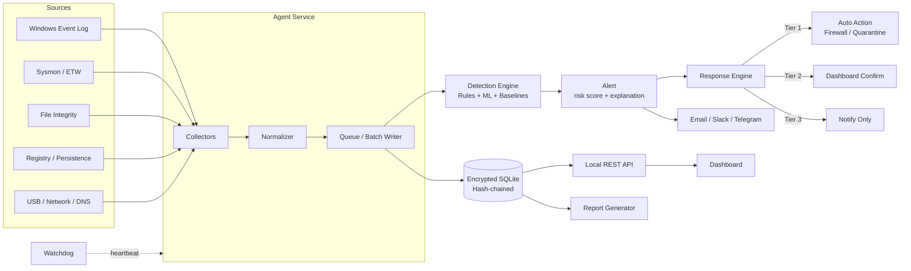

### 2. Process and Privilege Model

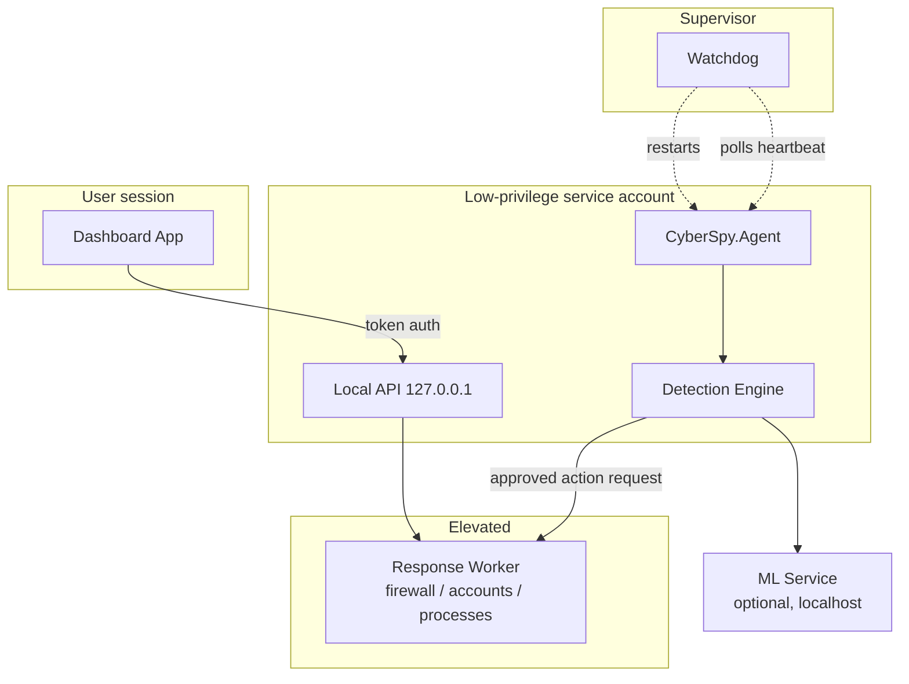

### 3. Brute-Force Demo (Sequence)

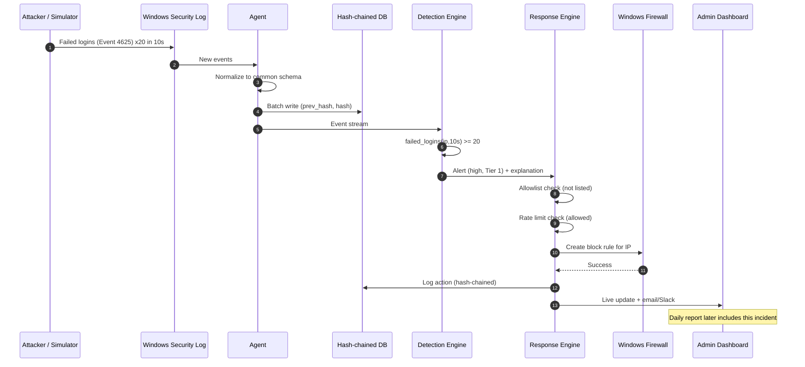

### 4. Detection Pipeline

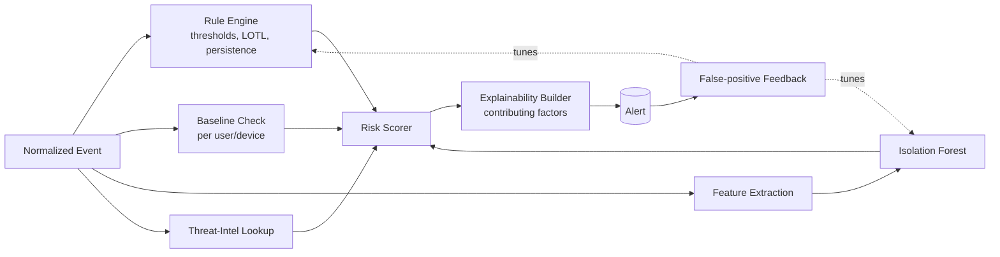

### 5. Response Decision Flow

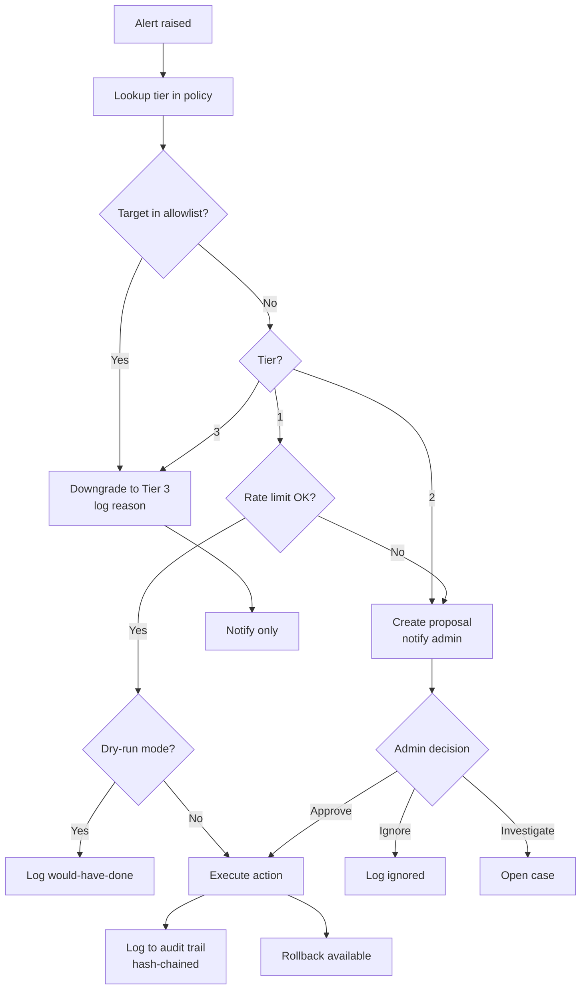

### 6. Hash Chain (Tamper Evidence)

```mermaid
flowchart LR
  G[Genesis<br/>prev=000...0] --> E1[Event 1<br/>hash1 = H(000 + data1)]
  E1 --> E2[Event 2<br/>hash2 = H(hash1 + data2)]
  E2 --> E3[Event 3<br/>hash3 = H(hash2 + data3)]
  E3 --> E4[Event 4<br/>hash4 = H(hash3 + data4)]
  E2 -. attacker edits .-> X[Event 2 modified<br/>hash2 changes]
  X -. breaks .-> E3
  E3 -. breaks .-> E4
  V[Verification job] -->|recompute and compare| E4
  S[Sealed chain head<br/>stored separately] --> V
```

### 7. Database ER Diagram

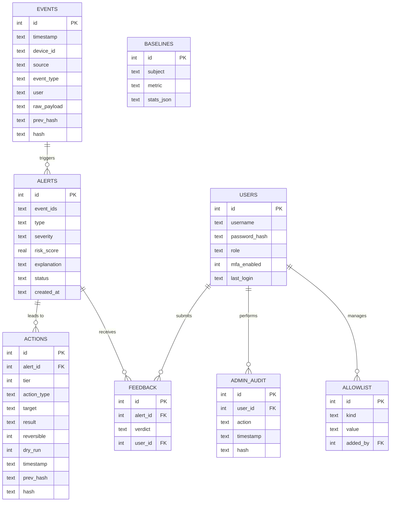

### 8. Alert and Case State Machine

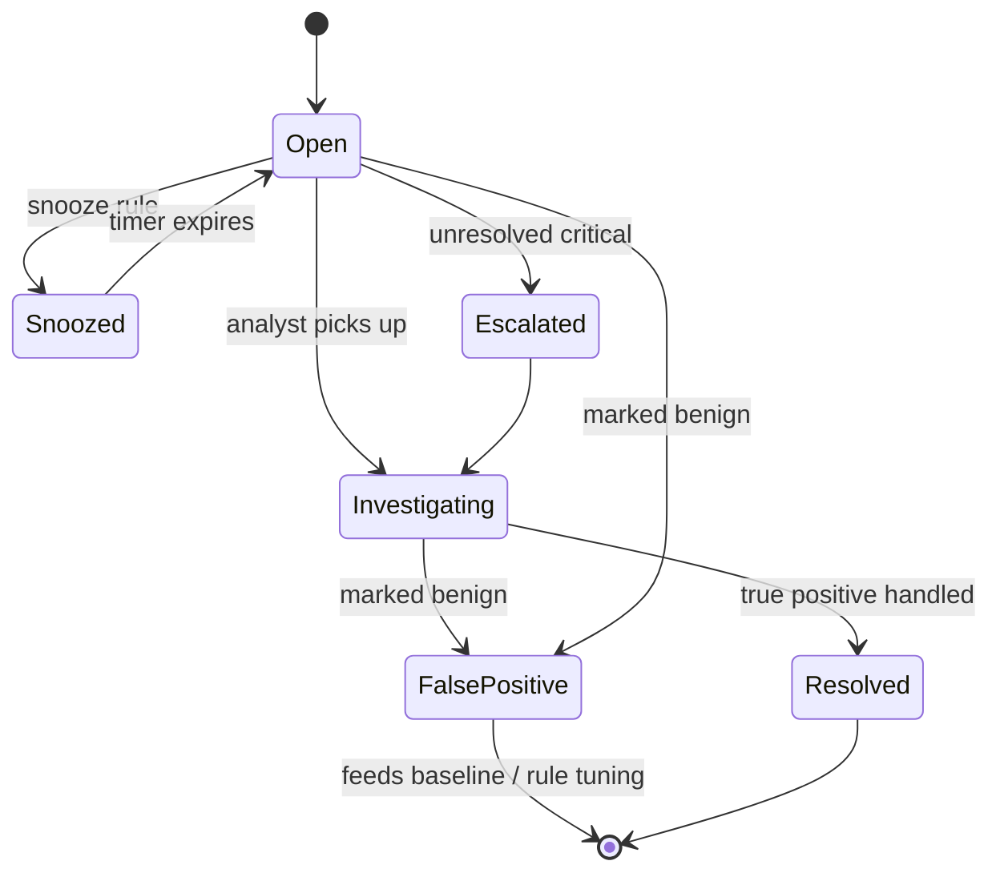

### 9. Agent Startup and Self-Protection

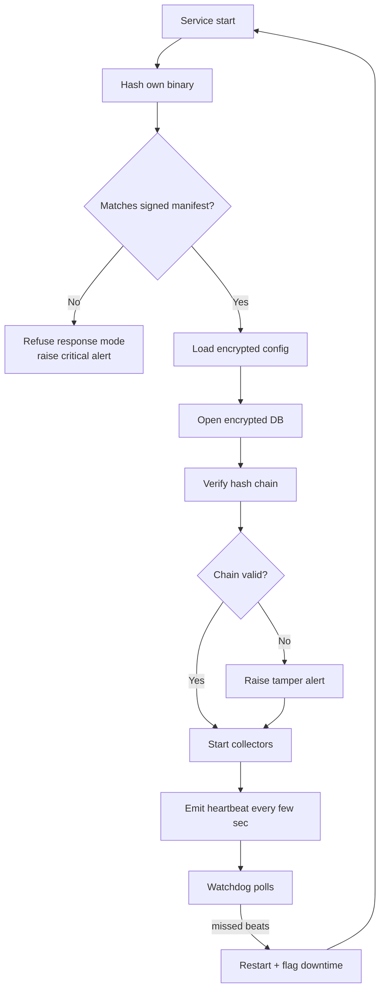

### 10. Trust Boundaries

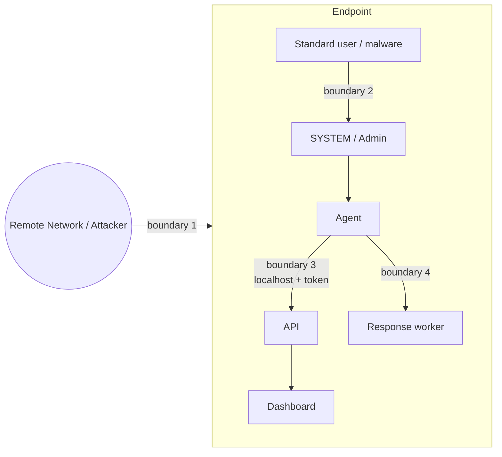

### 11. Role-Based Access Overview

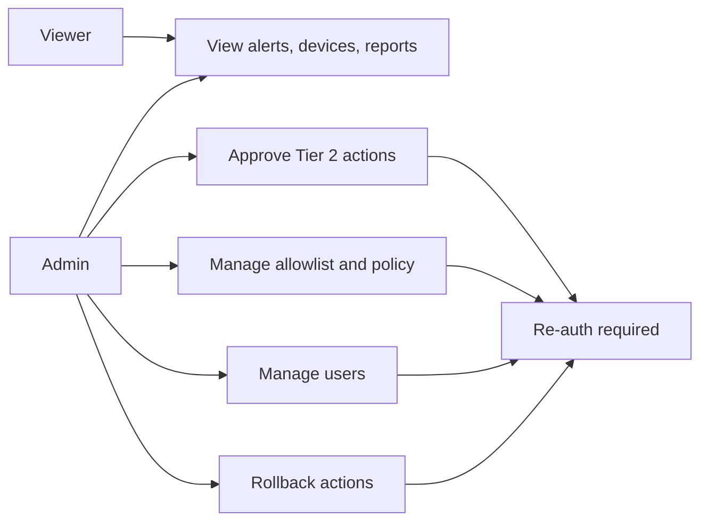

### 12. Daily Report Generation

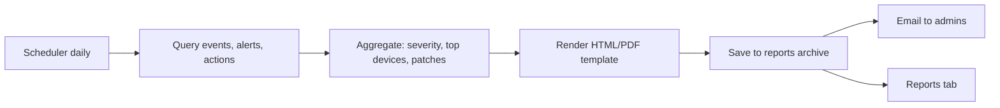

### 13. Roadmap Timeline

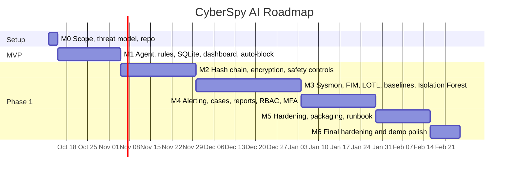

### 14. Feature Scope by Phase

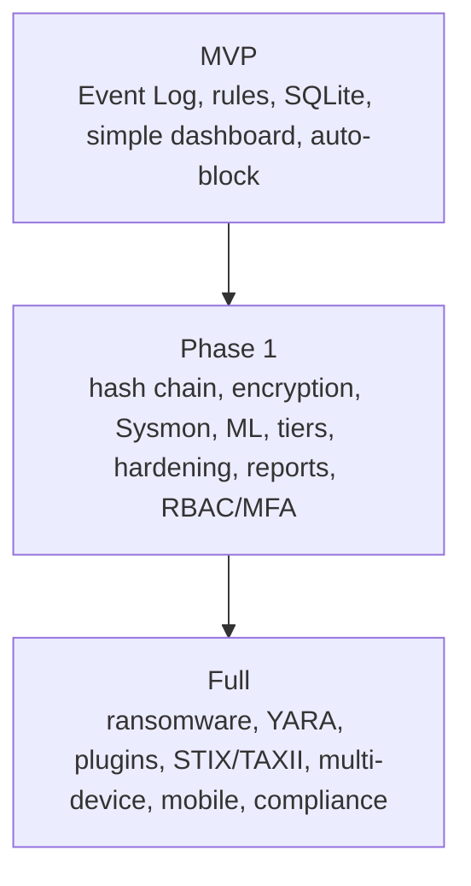

---

## Product Requirements Document: CyberSpy AI

### 1. Summary
CyberSpy AI is an installable Windows desktop application with a background agent service. It monitors authorized endpoints, detects suspicious behavior using rules plus machine learning, explains each alert with a risk score, and either alerts an admin or takes automated defensive action depending on confidence.

### 2. Problem
Individuals and small teams are flooded with raw alerts, miss real threats in the noise, and lack affordable Windows-desktop-focused monitoring (most tooling targets Linux server stacks: ELK, Wazuh, Elasticsearch). 

### 3. Goals
- G1: One app for collection, detection, response, and reporting.
- G2: Explainable alerts (why flagged, not just a number).
- G3: Safe automation via tiered response with allowlists, rate limits, rollback.
- G4: Tamper-evident local logging.
- G5: Easy install on Windows (no containers/servers).

### 4. Non-Goals
- True blockchain/distributed ledger (only local hash-chaining).
- Multi-device/distributed fleet management (future).
- Full automation of all response actions.
- Protection against zero-days, kernel/firmware rootkits, patient evasive adversaries, stolen-valid-credential misuse, or highly resourced targeted attacks.

### 5. Users and Personas
| Persona | Needs |
| --- | --- |
| Admin | Full control: config, response approval, allowlist, audit log |
| Viewer | Read-only dashboard/alerts/reports |
| Student/Evaluator (demo) | Simulation mode, clear end-to-end story |

### 6. Scope Phases
| Phase | Contents | Effort |
| --- | --- | --- |
| **MVP** | Event Log monitoring, rule-based detection, simple dashboard, one auto-block scenario (brute-force → firewall block) | 2–4 weeks |
| **Phase 1** | Core detection (rules + Isolation Forest + baselining), hash-chained encrypted storage, Tier 1/2 response, agent hardening, full dashboard, alerting, daily report | 2–4 months |
| **Full** | All features in sections below | Not solo-feasible |

### 7. Functional Requirements

#### FR-1 Data Collection
Priority key: **M** = MVP, **P1** = Phase 1, **F** = Full.
| ID | Requirement | Pri |
| --- | --- | --- |
| FR-1.1 | Windows Event Log (Security/System/Application) ingestion | M |
| FR-1.2 | Sysmon/ETW events (process, logon, network, driver load) | P1 |
| FR-1.3 | File integrity monitoring (hosts, startup folders, system binaries) | P1 |
| FR-1.4 | Registry/persistence monitoring (Run keys, services, scheduled tasks) | P1 |
| FR-1.5 | Process lineage / parent-child tracking | P1 |
| FR-1.6 | New local/admin account creation | P1 |
| FR-1.7 | Firewall and Defender status checks | P1 |
| FR-1.8 | USB insert/remove logging | P1 |
| FR-1.9 | Software inventory + outdated version tracking | F |
| FR-1.10 | Open port scanning | F |
| FR-1.11 | Network connection and DNS logging | P1 |
| FR-1.12 | Clipboard sensitive-pattern monitoring | F |
| FR-1.13 | Browser extension changes; saved-credential access | F |
| FR-1.14 | Driver install, BIOS/UEFI change, new hardware | F |
| FR-1.15 | Printer, Bluetooth, screen-share, VPN/proxy/Tor, cloud sync, Hyper-V/WSL | F |

#### FR-2 Storage and Integrity
| ID | Requirement | Pri |
| --- | --- | --- |
| FR-2.1 | Local SQLite database | M |
| FR-2.2 | SQLCipher encryption | P1 |
| FR-2.3 | Hash-chained events (prev_hash/hash) | P1 |
| FR-2.4 | Periodic automated chain verification | P1 |
| FR-2.5 | Rotation, retention, compression | P1 |
| FR-2.6 | Backup and restore | P1 |

#### FR-3 Detection
| ID | Requirement | Pri |
| --- | --- | --- |
| FR-3.1 | Threshold rules (e.g. brute force) | M |
| FR-3.2 | Severity-tiered risk scoring | M |
| FR-3.3 | Alert explainability (contributing factors stored) | P1 |
| FR-3.4 | Isolation Forest anomaly detection | P1 |
| FR-3.5 | Per-user/device baselining, time-of-day login anomaly | P1 |
| FR-3.6 | Living-off-the-land detection (powershell, certutil, mshta, wmic) | P1 |
| FR-3.7 | Threat-intel IP/domain reputation | P1 |
| FR-3.8 | False-positive feedback loop | P1 |
| FR-3.9 | Ransomware indicators (mass rename, shadow copy deletion), honeytokens | F |
| FR-3.10 | Credential stuffing, dormant account, service account misuse | F |
| FR-3.11 | YARA memory scan, process hollowing/injection, DLL sideloading | F |
| FR-3.12 | Exfiltration, basic DLP, DNS sinkholing | F |
| FR-3.13 | CVE lookup, missing updates, weak password policy | F |
| FR-3.14 | One-Class SVM, LSTM autoencoder, drift monitoring | F |
| FR-3.15 | Natural-language log querying | F |

#### FR-4 Response
| ID | Requirement | Pri |
| --- | --- | --- |
| FR-4.1 | Block IP via Windows Firewall rule | M |
| FR-4.2 | Tier 1 auto / Tier 2 confirm / Tier 3 alert-only | P1 |
| FR-4.3 | Allowlist, rate limiting, dry-run, one-click rollback, audit trail | M (allowlist, audit, dry-run), P1 (rest) |
| FR-4.4 | Kill process, quarantine file, disable account, force logoff | P1 |
| FR-4.5 | Network isolation of device | F |

#### FR-5 Alerting and Cases
Risk-sorted queue (M); email notification (P1); Slack/Telegram (F); SMS/voice escalation (F); dead-man's switch (P1); case states open → investigating → resolved (P1); sensitivity, snooze/suppress, escalation rules (F).

#### FR-6 Dashboard and Reporting
Live alert feed (M); device health view (P1); incident timeline (P1); top-issues-today (P1); daily HTML/PDF report emailed (P1); CSV/PDF export (P1); week-over-week trends (F); self-health dashboard (P1); compliance mapping NIST CSF/ISO 27001 (F); theme/accessibility (F); mobile companion/push (F).

#### FR-7 Access Control
Viewer/admin RBAC (P1); MFA (P1); session timeout + re-auth for sensitive actions (P1); forced credential setup on first run, no defaults (M); encrypted config (P1).

#### FR-8 Agent Hardening
Code-signed binary/installer (P1); startup self-integrity check (P1); watchdog with auto-restart (P1); least-privilege service (P1); anti-tamper vs stop/disable (F).

#### FR-9 Testing Tools
Attack simulation mode, EICAR support, dry-run mode (M for simulation and dry-run).

#### FR-10 Extensibility
REST API (P1); plugin architecture (F); STIX/TAXII feed import (F).

#### FR-11 Documentation
Threat model, runbook, architecture diagram, known limitations (M for threat model).

### 8. Non-Functional Requirements
| ID | Requirement |
| --- | --- |
| NFR-1 | Event-to-alert latency under 5 s for rule detections |
| NFR-2 | Agent idle CPU under 3%, memory under 200 MB (targets) |
| NFR-3 | No default credentials; secrets encrypted at rest |
| NFR-4 | Agent must fail safe: crash never triggers response actions |
| NFR-5 | Every automated action is logged, reversible where possible |
| NFR-6 | Windows 10/11 support |

### 9. Success Metrics
- End-to-end demo (brute force → block → log → notify → report) works repeatedly.
- Hash chain verification detects a deliberately edited row 100% of the time.
- Rule false-positive rate on benign test data under an agreed threshold (e.g. <1 alert/day/device).
- Dry-run vs live behaviors match.

### 10. Risks
| Risk | Mitigation |
| --- | --- |
| Scope explosion | Strict phase gates; MVP first |
| False-positive auto-block lockout | Allowlist, rate limit, rollback, dry-run |
| Agent being a target (runs privileged) | Least privilege, signing, integrity checks |
| ML cold-start / poor baselines | Rules first; ML after 30-day baseline |
| Sysmon dependency | Degrade gracefully to Event Log only |

### 11. Open Questions
- UI framework: WPF/WinUI 3 vs Tauri/Electron?
- ML runtime: Python sidecar vs ML.NET?
- Single admin vs multi-user in MVP?

---

## Architecture

### 1. Overview
**Collect → Store → Detect → Decide → Act → Report**

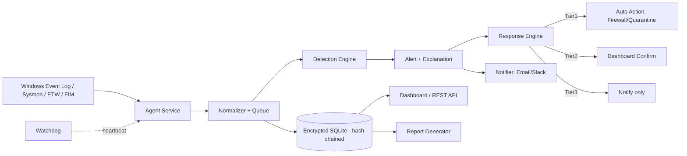

### 2. Components
| Component | Responsibility | Tech |
| --- | --- | --- |
| Agent service | Subscribe to event channels, normalize, batch-write, heartbeat, self-integrity check | .NET/C# Windows Service, EventLogWatcher, ETW |
| Watchdog | Poll heartbeat, restart agent, flag suspicious downtime | Separate small service |
| Storage | Encrypted DB, hash chain, retention, backup | SQLite + SQLCipher |
| Detection engine | Rules, baselines, anomaly scoring, LOTL patterns, explanation | C# rules + Python (scikit-learn/PyOD) or ML.NET |
| Response engine | Tier decisions, allowlist, rate limit, execute, rollback | C#, Windows Firewall API / PowerShell |
| API | Local REST API for dashboard and integrations | ASP.NET Core minimal API, localhost only |
| Dashboard | Alerts, devices, incidents, reports, admin | WPF/WinUI 3 (or Tauri) |
| Reporting | Daily HTML/PDF generation, email | ReportLab/WeasyPrint or .NET PDF lib |
| Scheduler | Daily reports, integrity verification | Task Scheduler or in-service timers |
| Notifier | Email, Slack, Telegram | SMTP, webhooks |

### 3. Process Model
- `CyberSpy.Agent` (service, low-privilege account; elevated actions delegated to the Response worker).
- `CyberSpy.Response` (service or in-agent module; only component with firewall/account/process rights).
- `CyberSpy.Watchdog` (service).
- `CyberSpy.ML` (optional Python local service on 127.0.0.1, or ML.NET in-process).
- `CyberSpy.Dashboard` (user-level desktop app talking to the local API).

### 4. Data Flow Example
1. Failed logon → Event ID 4625 in Security log.
2. Log tailer reads event within seconds, normalizes to `{timestamp, source, event_type, user, device, raw_payload}`.
3. Event enqueued, batch-written to DB with `prev_hash`/`hash`.
4. Detection engine evaluates rules/models, emits alert with `risk_score` + `explanation`.
5. Response engine: allowlist check → tier lookup → rate limit → action (or prompt).
6. Action logged to `actions` table, dashboard updated, notification sent.

### 5. Module Interfaces (conceptual)
```
IEventSource      : Start(), Stop(), event NormalizedEvent
IDetector         : Evaluate(NormalizedEvent) -> IEnumerable<Detection>
IResponseAction   : DryRun(target), Execute(target), Rollback(actionId)
INotifier         : Send(Alert)
```
Detectors and actions implement these so the Phase-2 plugin architecture is a small step.

### 6. Tech Stack
| Layer | Choice |
| --- | --- |
| UI | WPF or WinUI 3 (.NET 8) (alt: Tauri) |
| Agent | .NET 8 Worker Service |
| DB | SQLite + SQLCipher |
| ML | Python scikit-learn/PyOD sidecar or ML.NET |
| Response | Windows Firewall (netsh/NetSecurity PowerShell, COM API) |
| Packaging | MSIX or Inno Setup, code-signed |

### 7. Key Design Decisions
| Decision | Rationale |
| --- | --- |
| Local hash chain, not blockchain | Tamper evidence without consensus overhead |
| Rules first, ML second | Rules give near-zero FP on known attacks; ML covers unknowns |
| Tiered response | Automate only what's cheap to be wrong about |
| Localhost-only API + token auth | Reduce attack surface |
| Separate response privileges | Limit blast radius if agent is compromised |
| Fail-safe | Agent errors never trigger actions |

### 8. Deployment
Installer registers services, creates DB, forces first-run admin setup (no defaults), writes encrypted config, optionally installs Sysmon config. Config and DB under `%ProgramData%\CyberSpy` with restricted ACLs.

### 9. Observability
Self-health: agent CPU/memory, queue depth, DB size, last write, last heartbeat, chain verification status.

---

## Database Schema (SQLite + SQLCipher)

### Tables
```sql
CREATE TABLE events (
  id INTEGER PRIMARY KEY AUTOINCREMENT,
  timestamp TEXT NOT NULL,          -- ISO 8601 UTC
  device_id TEXT NOT NULL,
  source TEXT NOT NULL,             -- eventlog | sysmon | fim | registry | usb ...
  event_type TEXT NOT NULL,
  user TEXT,
  raw_payload TEXT NOT NULL,        -- JSON
  prev_hash TEXT NOT NULL,
  hash TEXT NOT NULL
);

CREATE TABLE alerts (
  id INTEGER PRIMARY KEY AUTOINCREMENT,
  event_ids TEXT NOT NULL,          -- JSON array
  type TEXT NOT NULL,
  severity TEXT NOT NULL,           -- low|medium|high|critical
  risk_score REAL NOT NULL,
  explanation TEXT NOT NULL,        -- JSON contributing factors
  status TEXT NOT NULL DEFAULT 'open', -- open|investigating|resolved|false_positive
  created_at TEXT NOT NULL
);

CREATE TABLE actions (
  id INTEGER PRIMARY KEY AUTOINCREMENT,
  alert_id INTEGER REFERENCES alerts(id),
  tier INTEGER NOT NULL,
  action_type TEXT NOT NULL,
  target TEXT NOT NULL,
  result TEXT NOT NULL,
  reversible INTEGER NOT NULL,
  dry_run INTEGER NOT NULL DEFAULT 0,
  rolled_back_at TEXT,
  timestamp TEXT NOT NULL,
  prev_hash TEXT NOT NULL,
  hash TEXT NOT NULL
);

CREATE TABLE users (
  id INTEGER PRIMARY KEY AUTOINCREMENT,
  username TEXT UNIQUE NOT NULL,
  password_hash TEXT NOT NULL,      -- Argon2id/bcrypt
  role TEXT NOT NULL,               -- viewer|admin
  mfa_enabled INTEGER NOT NULL DEFAULT 0,
  mfa_secret_enc TEXT,
  last_login TEXT
);

CREATE TABLE allowlist (
  id INTEGER PRIMARY KEY, kind TEXT, value TEXT, note TEXT, added_by INTEGER, added_at TEXT
);
CREATE TABLE baselines (
  id INTEGER PRIMARY KEY, subject TEXT, metric TEXT, stats_json TEXT, window_days INTEGER, updated_at TEXT
);
CREATE TABLE feedback (
  id INTEGER PRIMARY KEY, alert_id INTEGER, verdict TEXT, user_id INTEGER, created_at TEXT
);
CREATE TABLE admin_audit (
  id INTEGER PRIMARY KEY, user_id INTEGER, action TEXT, detail TEXT, timestamp TEXT, prev_hash TEXT, hash TEXT
);
CREATE INDEX idx_events_ts ON events(timestamp);
CREATE INDEX idx_alerts_status_sev ON alerts(status, severity);
```

### Hash chain
```
hash = SHA256( prev_hash || timestamp || device_id || source || event_type || user || raw_payload )
```
- Genesis row uses `prev_hash = 000...0`.
- Verification job walks rows in order, recomputes each hash, reports first mismatch (an edit breaks every later hash).
- Chain head is periodically sealed: store latest hash in a separate protected location (e.g. signed file or Windows Event Log entry) to detect wholesale truncation.
- Rotation: archive old segments with their terminal hash; next segment's genesis references it.

### Retention
Default 90 days events, 1 year alerts/actions; configurable. Compress archived segments.

---

## Detection and Response Design

### 1. Detection layers
| Layer | Catches | Phase |
| --- | --- | --- |
| Threshold rules | Brute force, known-bad IPs, new admin account | MVP |
| Signature/pattern rules | LOTL (powershell -enc, certutil, mshta, wmic), persistence keys | P1 |
| Baselining | Unusual login hours, new source IPs per user | P1 |
| Isolation Forest | Statistically abnormal sessions | P1 |
| Ransomware/memory/identity detectors | Mass rename, shadow copy deletion, YARA, hollowing | Full |
| LSTM autoencoder, drift monitoring | Sequence anomalies | Full |

### 2. Example rules
```
brute_force:   failed_logins(user|ip, 60s) >= 5   -> severity medium
brute_force_hard: failed_logins(ip, 10s) >= 20    -> severity high, Tier 1
lotl_powershell: process=powershell.exe
                 AND parent NOT IN (explorer.exe, cmd.exe, known_admin_tools)
                 AND cmdline CONTAINS (-enc, -EncodedCommand) -> severity high
shadow_copy_delete: cmdline MATCHES (vssadmin delete shadows | wmic shadowcopy delete) -> critical
new_admin: Event 4720 + 4732 (admin group add)    -> high
```

### 3. ML details
- Features per session: `login_hour, source_ip_entropy, process_count_spawned, bytes_sent, bytes_received`.
- Train on a rolling window of normal sessions (min 30 days before enabling scoring).
- Baseline: login hour distribution per user over 30 days; flag at 3+ standard deviations.
- Output: anomaly score 0 to 1 mapped to risk score.

### 4. Explainability
Every alert stores contributing factors, e.g.:
```json
{"risk_score": 82, "factors": [
  {"name":"unusual_login_hour","detail":"3:14 AM; normal 9-18","weight":0.35},
  {"name":"new_source_ip","detail":"never seen for this account","weight":0.30},
  {"name":"recent_failures","detail":"2 failed attempts in 5 min","weight":0.17}]}
```

### 5. False-positive feedback loop
Analyst marks alert true/false positive → stored in `feedback` → rules get suppress/threshold suggestions; ML threshold adjusted and false positives excluded from retraining windows (with review to avoid poisoning).

### 6. Response tiers
| Tier | Mode | Used when |
| --- | --- | --- |
| 1 | Automatic | High confidence, low collateral |
| 2 | Human-confirmed | Medium confidence |
| 3 | Alert only | Low confidence / informational |

#### Decision table
| Condition | Tier | Action |
| --- | --- | --- |
| Failed logins >= 20 in 10s from one IP | 1 | Block IP at Windows Firewall |
| File hash matches known-malware list | 1 | Quarantine file |
| Isolation Forest score > 0.85 | 2 | Prompt: Block / Ignore / Investigate |
| LOTL process chain match | 2 | Prompt with explanation |
| Unusual-hour login, no other signal | 3 | Log and notify only |

#### Available actions
Block IP, disable user, kill process, isolate device, quarantine file, force logoff.

#### Safety mechanisms
1. Allowlist check before every action (admin IPs, domain controllers, critical processes).
2. Rate limit (e.g. max N blocks/minute; cap on subnet-wide blocks).
3. Dry-run mode: log "would have done X".
4. One-click rollback (remove firewall rule, re-enable account, restore from quarantine).
5. Full audit trail in hash-chained `actions` table.
6. Fail-safe: detection engine errors never cause actions.

### 7. Response pseudocode
```
on alert:
  tier = policy.lookup(alert)
  if target in allowlist: downgrade to Tier 3, log reason
  if tier == 1:
     if rate_limiter.allow(action): execute (or dry-run) and log
     else: downgrade to Tier 2
  elif tier == 2: create pending proposal, notify admin
  else: notify only
```

---

## Threat Model (One-Page)

### Assets
Endpoint integrity, event log/telemetry, the CyberSpy database and config, admin credentials, response capability (firewall/account control).

### In scope (attackers/behaviors we aim to detect)
- Brute-force and password-guessing logins (RDP/local)
- Port scans and suspicious network connections to known-bad destinations
- Persistence via Run keys, services, scheduled tasks
- Suspicious process chains and living-off-the-land abuse
- Unauthorized file tampering (hosts, startup, system binaries)
- Common ransomware indicators
- Anomalous login timing/source
- Log tampering attempts (via hash chain)

### Out of scope
Zero-day exploits, kernel/firmware rootkits, a patient adversary deliberately evading baselines, misuse of legitimately stolen credentials, highly resourced targeted attacks, network-wide fleet defense (single endpoint first).

### Assumed attacker capability
- Initially: unprivileged remote or local user, or malware running as standard user.
- Possible: attempts to escalate, edit/delete logs, stop the agent.
- Not assumed: kernel-level control or physical hardware implants.

### Trust boundaries
Remote network ↔ endpoint; standard user ↔ SYSTEM/admin; Dashboard ↔ Agent API (localhost); Agent ↔ Response worker.

### Threats to CyberSpy itself (STRIDE-style)
| Threat | Mitigation |
| --- | --- |
| Log tampering | Hash chain + sealed head + periodic verification |
| Agent stopped/disabled | Watchdog, downtime flagging, service ACLs, dead-man's switch |
| Binary replaced | Code signing, startup self-integrity check vs signed manifest |
| Credential theft / default creds | Forced first-run setup, hashed passwords, MFA |
| API abuse | Localhost bind, token auth, RBAC |
| Response abuse (self-DoS via spoofed events) | Allowlist, rate limits, tiering |
| DB theft | SQLCipher, encrypted config, ACLs |
| ML poisoning | Review feedback, rolling windows, drift monitoring |

### Known limitations
See "Out of scope". CyberSpy is an additional layer, not a replacement for Defender, updates, MFA/password manager, and backups.

---

## Security Requirements

### Access control
- Roles: `viewer` (read) and `admin` (config, response, users, allowlist).
- Forced credential creation on first run; no default accounts.
- Passwords hashed with Argon2id (or bcrypt); lockout/backoff on failures.
- MFA (TOTP) for dashboard login.
- Session timeout; re-auth for sensitive actions (disable account, isolate device, change allowlist).
- Every admin action written to `admin_audit`.

### Config and secrets
- Config encrypted (DPAPI machine scope or key in SQLCipher).
- DB key protected via DPAPI; never in plaintext config.
- ACLs on `%ProgramData%\CyberSpy` restricted to SYSTEM/Administrators.

### Agent hardening
- Code-signed binaries and installer.
- Startup self-integrity check (hash vs signed manifest); refuse to run in response mode if failed.
- Watchdog with auto-restart; heartbeat every few seconds; suspicious downtime flagged.
- Least-privilege service account; only the Response worker holds elevated rights.
- Anti-tamper: service ACLs against unauthorized stop/disable, alert on service state change.

### Secure development
Dependency scanning, no secrets in repo, input validation on all event payloads (treat logs as untrusted data: no injection into UI/PowerShell commands), parameterized SQL, sanitized values when building firewall commands.

---

## Testing Plan

### Levels
| Level | Scope | Tools |
| --- | --- | --- |
| Unit | Normalizer, rules, hash chain, allowlist, rate limiter | xUnit/NUnit, pytest |
| Integration | Agent → DB → detection → response | Test event replay |
| System | Install, services, dashboard, reports | VM snapshot (Windows 10/11) |
| Security | Tamper tests, privilege checks, API auth | Manual + scripts |
| Performance | CPU/RAM, event throughput | PerfMon |

### Key test cases
1. Replay 4625 events at 20 in 10s → Tier 1 block created exactly once.
2. Source IP in allowlist → no block, alert downgraded, reason logged.
3. Rate limiter: 100 distinct IPs in a minute → cap enforced, rest become Tier 2.
4. Edit one DB row manually → chain verification reports the first broken row.
5. Delete a row → verification fails.
6. Kill agent → watchdog restarts; downtime logged.
7. Modify agent binary → self-integrity check fails at startup.
8. Dry-run mode → no firewall change, action logged as dry-run.
9. Rollback → firewall rule removed, rollback audited.
10. EICAR file → detected and quarantined (Tier 1).
11. Encoded PowerShell from unusual parent → Tier 2 prompt with explanation.
12. First run without credentials setup → app refuses to operate.
13. Viewer attempts admin action → denied and audited.

### Attack simulation mode
Safe built-in triggers: generate synthetic failed-login events, synthetic port-scan connection pattern, drop EICAR. Clearly labeled `simulated=true` and only targets the local machine.

### Demo scenario (end-to-end)
1. Run brute-force simulation against local login.
2. Agent logs 4625 events within seconds.
3. Rule crosses 20-in-10s → Tier 1 alert.
4. Allowlist check passes (not listed); rate limiter allows.
5. Firewall block rule created.
6. Action written to hash-chained `actions` table with justification.
7. Dashboard feed shows block live; email/Slack sent.
8. Daily report includes the incident with evidence.
9. Run chain verification → passes; edit a row → fails.

### Acceptance for MVP
Steps 1-6 plus dashboard visibility pass reliably 10/10 runs.

---

## Roadmap

| Milestone | Deliverable | Duration |
| --- | --- | --- |
| M0 | Scope lock, threat model, repo + CI setup | 2-3 days |
| M1 (MVP) | Event Log agent, rules, SQLite, simple dashboard, one auto-block | 2-4 weeks |
| M2 | Hash-chained + encrypted storage, allowlist/rate limit/rollback/dry-run, audit | 3-4 weeks |
| M3 | Sysmon/FIM/registry/process lineage, LOTL rules, baselining, Isolation Forest, explainability | 4-6 weeks |
| M4 | Dashboard completion, alerting (email), cases, daily report, RBAC + MFA | 3-4 weeks |
| M5 | Agent hardening (signing, watchdog, integrity), packaging, runbook | 2-3 weeks |
| M6 (Phase 1 complete) | Hardening pass, docs, demo polish | 1-2 weeks |
| Later | Ransomware, YARA, plugins, STIX/TAXII, multi-device, mobile | Backlog |

### Gate criteria
- M1 → M2: demo scenario works 10/10.
- M3 → M4: false-positive rate acceptable on 1 week of benign data.
- M5 → done: all TESTING_PLAN cases pass in a clean VM.

---

## Tasks

Legend: `[ ]` todo. Priority: P0 critical, P1 important, P2 nice. Est: S (≤½ day), M (1-2 days), L (3+ days).

### Phase 0: Setup
- [ ] P0 S Lock scope (MVP → Phase 1)
- [ ] P0 S Write threat model (see THREAT_MODEL.md)
- [ ] P0 S Decide UI framework (WPF/WinUI 3/Tauri) and ML runtime (Python vs ML.NET)
- [ ] P0 S Create repo, solution structure, .editorconfig, CI build/test
- [ ] P0 S Set up Windows 10/11 test VM with snapshots
- [ ] P1 S Install Sysmon in VM with baseline config

### Phase 1: MVP (2-4 weeks)
#### Agent
- [ ] P0 M .NET Worker Service skeleton, install/uninstall as Windows Service
- [ ] P0 M Event Log subscriber (Security, System, Application) via EventLogWatcher
- [ ] P0 M Normalizer to common schema; unit tests with sample 4625/4624/4720 XML
- [ ] P0 S In-memory queue + batched writer
#### Storage
- [ ] P0 M SQLite schema (events, alerts, actions, users)
- [ ] P0 S Data access layer, migrations
#### Detection
- [ ] P0 M Rule engine with sliding-window counters
- [ ] P0 S Brute-force rules (5/60s medium, 20/10s high)
- [ ] P0 S Alert creation with severity + basic explanation
#### Response
- [ ] P0 M Firewall block (create/remove rule for IP)
- [ ] P0 S Allowlist check
- [ ] P0 S Dry-run mode
- [ ] P0 S Action logging
#### Dashboard
- [ ] P0 M Local API (alerts, actions, status)
- [ ] P0 M Dashboard: live alert feed, action list
- [ ] P0 S First-run admin setup (no default creds)
#### Demo
- [ ] P0 M Brute-force simulation tool
- [ ] P0 S End-to-end demo run + notes
**Exit:** demo scenario steps 1-6 work 10/10.

### Phase 2: Phase 1 build-out
#### Storage and integrity
- [ ] P0 M SQLCipher integration + DPAPI key protection
- [ ] P0 M Hash-chained events and actions
- [ ] P0 M Verification job + sealed chain head
- [ ] P1 M Retention, rotation, compression
- [ ] P1 M Backup and restore
#### Collection
- [ ] P0 L Sysmon/ETW ingestion (process, network, driver load)
- [ ] P1 M File integrity monitoring (hosts, startup, system binaries)
- [ ] P1 M Registry/persistence monitor (Run keys, services, tasks)
- [ ] P1 M Process lineage tracking
- [ ] P1 S New account/admin group detection
- [ ] P1 S Firewall/Defender status checks
- [ ] P1 S USB insert/remove
- [ ] P1 M DNS/network connection logging
#### Detection
- [ ] P0 M LOTL rules (powershell, certutil, mshta, wmic)
- [ ] P0 L Per-user baselining (login hours)
- [ ] P0 L Isolation Forest pipeline (feature extraction, training, scoring)
- [ ] P0 M Explainability record + UI rendering
- [ ] P1 M False-positive feedback loop
- [ ] P1 M Threat-intel IP/domain lookup (offline list first)
#### Response
- [ ] P0 M Tier system and decision policy
- [ ] P0 M Rate limiter
- [ ] P0 M One-click rollback
- [ ] P1 M Kill process, quarantine file, disable account, force logoff
- [ ] P1 M Tier 2 proposal queue + confirm UI
#### Alerting and cases
- [ ] P1 M Email notifications
- [ ] P1 M Case states (open/investigating/resolved)
- [ ] P1 S Snooze/suppress
- [ ] P1 M Dead-man's switch
#### Dashboard and reporting
- [ ] P1 M Device view, incident timeline, top issues today
- [ ] P1 M Self-health dashboard
- [ ] P1 L Daily HTML/PDF report + email schedule
- [ ] P1 S CSV/PDF export
- [ ] P1 M Admin audit log view
#### Access control
- [ ] P0 M RBAC (viewer/admin)
- [ ] P0 M MFA (TOTP)
- [ ] P1 S Session timeout + re-auth for sensitive actions
- [ ] P1 S Encrypted config file
#### Agent hardening
- [ ] P0 M Watchdog service + heartbeat
- [ ] P0 M Startup self-integrity check
- [ ] P1 M Least-privilege service account; split Response worker
- [ ] P1 M Code-sign binaries and installer
- [ ] P1 M Packaging (MSIX/Inno Setup)
#### Extensibility and docs
- [ ] P1 M REST API hardening and docs
- [ ] P1 S Runbook, architecture diagram, known limitations
#### Testing
- [ ] P0 L Implement TESTING_PLAN cases 1-13
- [ ] P1 S EICAR support

### Backlog (Full scope)
- [ ] Ransomware indicators, honeytokens
- [ ] YARA memory scanning, process hollowing/injection, DLL sideloading
- [ ] Credential stuffing, dormant account, service account misuse
- [ ] Exfiltration/DLP, DNS sinkholing
- [ ] CVE lookup, missing updates, weak password policy
- [ ] Clipboard, browser extension, saved-credential, BIOS/UEFI, Bluetooth, printer, screen-share, VPN/Tor, cloud sync, Hyper-V/WSL monitors
- [ ] One-Class SVM, LSTM autoencoder, drift monitoring, NL log query
- [ ] Slack/Telegram, SMS/voice escalation, escalation rules
- [ ] Plugin architecture, STIX/TAXII import
- [ ] NIST CSF / ISO 27001 mapping, themes/accessibility, mobile push
- [ ] Network isolation, anti-tamper service protections
- [ ] Multi-device architecture
